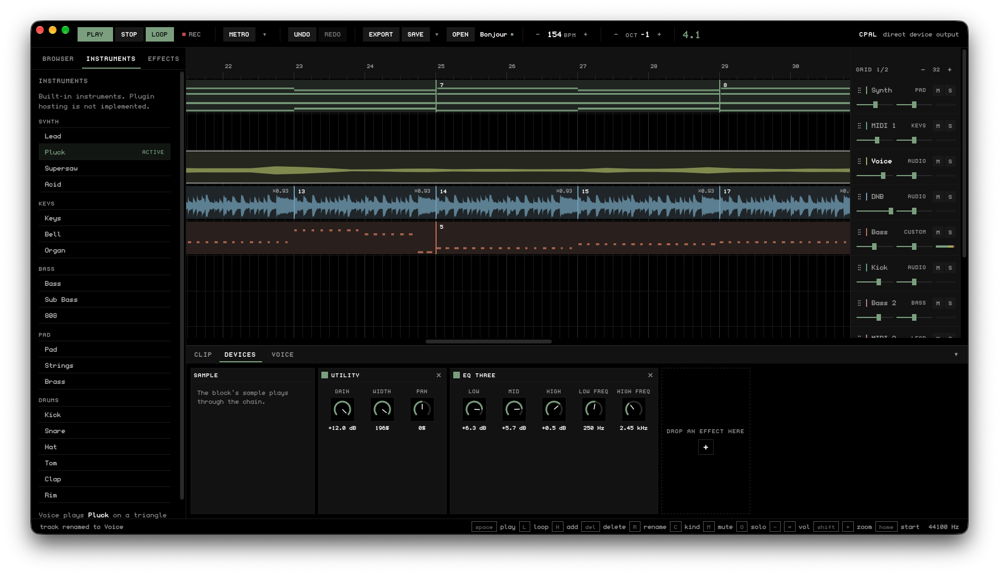

# cassette

A session DAW inspired by Ableton Live. Lay out MIDI and audio tracks on a beat
timeline, place a block at a position with a length in beats, and play the
built-in polyphonic synth from your keyboard.

The audio engine is Rust and does all the timing and synthesis. The interface is
SvelteKit, served by a thin Tauri shell. The webview only draws: it sends intent
and reads a snapshot the engine publishes once a frame.



```
cassette/
├── src/              the engine and the app logic (crate: cassette)
├── tests/            engine integration tests
├── docs/             architecture notes
└── app/              the desktop app
    ├── src/          SvelteKit frontend (routes, components, session store, keymap)
    └── src-tauri/    the Tauri shell: the command surface over an engine thread
```

A block carries a start and a length in beats, so it sits at a position on a
track's lane: a MIDI lane takes MIDI blocks, an audio lane takes blocks that name
a sample. A MIDI block holds no notes yet, so a MIDI track still plays from the
keyboard; an audio block plays its sample when the playhead reaches it.

The window is a transport bar, a left sidebar with three tabs (file browser, VST,
effects) and the timeline: a ruler, one lane per track, blocks and the playhead.

State, 2026-09-24. The timeline has landed and `cargo test` is green end to end:
147 library unit tests, 24 integration tests, and the frontend type-checks with
83 unit tests of its own. `cargo fmt` and `cargo clippy --all-targets -D warnings`
are clean.
[ROADMAP.md](./ROADMAP.md) 6.1 to 6.6 say what works and what is still missing.

## Run it

[mise](https://mise.jdx.dev) pins Rust and bun and wraps every step, on Linux,
macOS and Windows:

```bash
mise install           # Rust 1.98.1 with clippy and rustfmt, bun 1.4.2
mise run deps          # Tauri's system libraries (apt, dnf, pacman or Xcode tools)
mise run dev           # dev window, frontend hot-reloads
mise run build         # bundle for this platform
mise run test          # engine and frontend tests
mise run check         # fmt, clippy and svelte-check
```

On Windows, `mise run deps` points at the Microsoft C++ Build Tools and WebView2
instead of installing them. Vite runs on bun, so no Node.js install is needed.

Without mise, install Rust, [bun](https://bun.sh) and the
[Tauri prerequisites](https://v2.tauri.app/start/prerequisites/), then:

```bash
cd app
bun install
bun run tauri dev      # dev window, frontend hot-reloads
bun run tauri build    # bundle for this platform
```

The engine on its own needs neither a webview nor those system libraries:

```bash
cargo test             # 81 tests at the v0.2.0 tag
cargo clippy --all-targets
```

## Controls

| Key | Action |
|-----|--------|
| `space` | play / stop |
| `L` | toggle looping |
| `F9` | arm MIDI recording into the selected MIDI track; starts the transport |
| double-click an empty lane | select the track and put the marker there; play starts from it and stop returns to it |
| `shift` `tab` | switch the detail pane between Clip and Devices |
| `ctrl` `U` (`cmd` on macOS) | quantize the open clip, or the selected MIDI block, to the grid |
| `up` `down` | move between tracks |
| `left` `right` | move between blocks on the selected track |
| `N` / `enter` | add a block to the selected track |
| `backspace` / `del` | delete the block under the cursor |
| `C` | flip the track between MIDI and audio |
| `R` | rename the block under the cursor |
| `esc` | cancel the rename |
| `-` `=` | track volume |
| `[` `]` | pan left / right |
| `,` `.` | tempo |
| `M` `O` | mute / solo the selected track |
| `Z` `X` | shift the play octave |
| `A W S E D F T G Y H U J K` | play notes |
| `shift` `+` / `shift` `-`, numpad `+` / `-` | zoom the timeline |
| `ctrl` / `cmd` + scroll, or pinch | zoom the timeline around the pointer |
| `home` | scroll back to the top of the song |
| `shift` + drag on the ruler | draw the loop region; double-click it to loop the whole song |
| `P` | open the piano roll on the selected MIDI block |
| `esc` | close the piano roll |
| `backspace` / `del` in the roll | delete the selected note |
| `B` | split the block under the pointer at the hover line (the selected block at the playhead when the pointer is off every block) |
| `ctrl` `E` (`cmd` on macOS) | split the selected block at the playhead |
| `ctrl` `Z` / `ctrl` `shift` `Z` or `ctrl` `Y` (`cmd` on macOS) | undo / redo an edit |
| `ctrl` `D` (`cmd` on macOS) | duplicate the selected block (or selection range, or notes) |
| `ctrl` `C` / `ctrl` `X` / `ctrl` `V` (`cmd` on macOS) | copy / cut / paste time selection range or notes |
| `ctrl` `L` (`cmd` on macOS) | loop the arrangement time selection |
| `ctrl` `T` (`cmd` on macOS) | add an audio track |
| `ctrl` `shift` `T` (`cmd` on macOS) | add a MIDI track |
| `ctrl` `S` / `ctrl` `shift` `S` (`cmd` on macOS) | save / save as project (`.cassette`) |
| `ctrl` `O` (`cmd` on macOS) | open project |
| `B` in the roll | toggle note draw mode |
| `+` / `-` in the roll | zoom piano roll in / out (up to 2048 px/beat) |
| drag empty lane space | draw arrangement time selection range |
| drag a note's left edge | resize note start while pinning its end |
| drag a block's left edge | trim its start; the end stays put |
| `shift` + drag an audio block's right edge | stretch it (the rate changes, so pitch follows) |

Commands sit on keys the piano row does not use, so playing and editing never
collide: notes are checked first, and a key bound to both would make the command
silently unreachable. `app/src/lib/keys.ts` refuses to load if that ever happens.

The zoom keys are handled in the webview, because no engine event describes them.

A dashed hover line follows the pointer across the lanes and marks the beat a
split or a click lands on, with its `bar.beat.hundredths` position in the header
corner; hold `alt` to free it from the grid. The grid follows the zoom: it
snaps to the finest step from 1/16 beat to 2 beats that stays at least 12 px
wide, and the header corner shows the current step. Undo covers every edit to the song
(blocks, notes, the mixer, the voice and the tempo); a drag or a fader move is one
step. Selection, the transport and the loop region are not undone.

Everything is also clickable: the transport, the sidebar tabs, the track faders
and their M/S buttons, and the blocks, which drag along and between lanes, resize
from their right edge, and are created from a lane's right-click menu.
Double-clicking a MIDI block opens its piano roll under the timeline: click the
grid to add a note, drag it to move it, drag its right edge to resize it, scroll
over it to change its velocity (`shift` for single steps), and click a key on the
left to hear it. `alt` turns off snapping to the 1/4-beat grid. A `.wav` in
the file browser drags onto a lane, or imports into the selected track on a
double-click.

## Audio backends

The engine picks the best sink it can and names it in the transport bar:

1. **cpal** — direct device output, lowest latency. The desktop app builds with
   the engine's `cpal` feature on.
2. **ffplay** — streams raw `f32` PCM into ffmpeg's player. Needs no development
   headers, but the player must be able to open your audio device.
3. **silent** — the transport still runs and the meters still move; nothing comes
   out. The app falls back to this if no device is reachable, so the window
   always opens.

A fourth backend, `stream`, sends raw PCM over a loopback TCP socket instead of
opening a device. The engine never picks it automatically; you select it with
`CASSETTE_STREAM_PORT` (or `ZBOUB_STREAM_PORT`), below.

### Getting sound

If the transport bar says `silent`, the note after it says why. The usual causes:

* **No permission on `/dev/snd`.** Add yourself to the `audio` group, then log
  out and back in:
  ```bash
  sudo usermod -aG audio "$USER"
  ```
* **The ALSA `default` device points at hardware you do not have** (for example
  a machine with only HDMI outputs). Route it somewhere real with `~/.asoundrc`,
  or build with the `cpal` feature, which enumerates every output.

You do not need a working audio device to compose: the transport, the meters and
the keyboard all behave the same on the silent backend.

### Audio over SSH

The `stream` backend renders on the machine running the engine and writes raw PCM
to a loopback socket, which you forward over SSH and play locally. This is opt-in:
the default app picks a device backend and does not stream. Start the app with
`CASSETTE_STREAM_PORT` set to the port you want:

```bash
CASSETTE_STREAM_PORT=9999 bun run tauri dev      # from app/
```

Any `u16` greater than zero selects the streaming backend. Unset, empty,
unparseable or zero leaves the app on its normal device backend. A port that
cannot be bound does not fall back to your sound card: the engine runs silent and
the header shows the bind error, so the window always opens and says why. The
header renders `backendNote`, which carries the port to forward. The protocol notes and the ffplay side are in
[`docs/music-over-ssh.md`](./docs/music-over-ssh.md).

## Architecture

Dependencies point inward, and the audio path never touches the interface:

```
input ──► events ──► core ◄── ui
                       ▲
                     models   (shared data only)
```

```
src/
├── lib.rs             public API (crate name: cassette)
├── app/               intent handling + the UiState snapshot
│                      (timeline, tracks, samples, transport)
├── core/              audio engine — no frontend, no terminal
│   ├── synth.rs       polyphonic voices + ADSR + the sample voice
│   ├── render.rs      RenderCore + Transport + the RtCommand vocabulary
│   ├── sample.rs      SamplePool + the SampleMsg ring (audio-side storage)
│   ├── wav.rs         hand-written WAV decoder, PCM and float, downmixed to mono
│   ├── audio.rs       backends (cpal / ffplay / silent / stream) + SharedState
│   ├── engine.rs      control side: the two rings + shared state
│   └── meter.rs       level meters
├── events/            bounded fan-out EventBus + typed Event
├── input/             MIDI/OSC adapters
├── models/            Song, Track, Block, Instrument — plain data
├── ui/                UiState — the serializable snapshot the webview draws
└── utils/             pitch, tempo and math helpers

app/src/lib/           SvelteKit frontend
├── wire.ts            the wire contract (UiState, EngineEvent, sample entries)
├── api.ts             one function per Tauri command
├── keys.ts            keymap: piano row, commands, zoom keys
├── keyboard.ts        the window listener that drives the store
├── geometry.ts        beats to pixels, snapping, bar maths
├── pianoRoll.ts       piano roll geometry: pitch rows, hit tests, note clamps
├── noteCache.ts       notes the webview holds, so idle frames carry none
├── palette.ts         the eight track colours
├── *.svelte.ts        the stores: session state, block drags, sample drags
└── components/        Sidebar + panes, Timeline + its parts, Transport, StatusBar

app/src-tauri/src/
├── lib.rs             the commands (state, send, sample browser) + the thread
└── main.rs            desktop entry point
```

### Why the engine has its own thread

The engine owns a cpal `Stream`, and cpal marks `Stream` `!Send` and `!Sync` on
every platform. It therefore cannot live in Tauri's managed state, which must be
`Send + Sync`. So the shell gives it a thread of its own: the webview sends
intent down a channel, and the engine thread applies it and publishes a snapshot.

A command wakes that thread at once instead of on the next frame, so a note
sounds the moment the key goes down. Nothing about timing or synthesis is
decided in JavaScript, and the webview cannot draw faster than 60 Hz anyway.

### Real-time contract

`core::render::RenderCore::process` runs inside the audio callback. It never
allocates, locks, performs I/O or panics: voices and the transport are
fixed-size, commands cross threads through an `rtrb` SPSC ring buffer, and state
comes back through atomics. The per-track block mirror is a plain `Vec` the
control thread builds and hands over whole with `RtCommand::SetBlocks`, so the
callback only ever reads one it already owns. Samples take the same route: the
control thread decodes the file and sends the frames down a second `rtrb` ring
as an `Arc` slice it keeps a clone of, so the callback only swaps a handle and
never frees a buffer. The note mirror travels like the block mirror.
`tests/test_rt_no_alloc.rs` runs the render loop and the command path under
`assert_no_alloc`, so the claim fails the build rather than the audio thread if it
ever stops being true.

See `docs/ARCHITECTURE.md` for the full layer rules and `ROADMAP.md` for status.

## Testing

81 tests at the v0.2.0 tag: unit tests for every engine module plus integration
tests for the engine, the TCP stream backend and the MIDI/OSC adapters.

```bash
cargo test
cargo clippy --all-targets   # clean at v0.2.0
```

The frontend type-checks and its pure helpers have unit tests:

```bash
cd app && bun run check    # type-check
cd app && bun test         # keymap and geometry tests
```

`bun test` and `bun run test` run `app/src/lib/keys.test.ts` for the keymap in
`app/src/lib/keys.ts` and `app/src/lib/geometry.test.ts` for the timeline maths in
`app/src/lib/geometry.ts`.

State measured on 2026-09-24, while Phase 6 landed: the engine library compiles
and the integration tests pass on their own

```bash
cargo test --test test_engine --test test_input_adapters --test test_rt_no_alloc
```

24 tests, plus the library's own 147. See [ROADMAP.md](./ROADMAP.md).